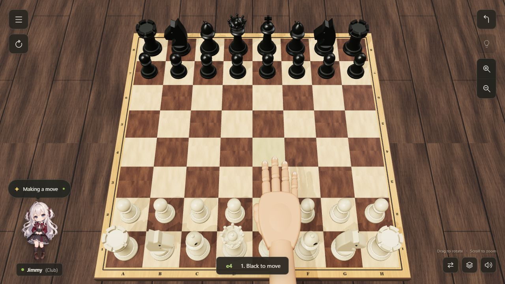

# The Wooden Table — 3D Chess

A browser chess game with a wooden board, sculpted pieces, an animated human hand, and a computer opponent. The board, pieces, grain, shadows, and camera are rendered live in Three.js. The companion is an original generated illustration.

## Run locally

The supplied `3D-Chess.html` is a complete standalone edition: double-click it to play, with no installation or server required.

To run the editable source, with Node.js installed, double-click `START.cmd` on Windows or run `npm start` in this folder. Open http://127.0.0.1:4173. All game libraries and artwork are included locally; no CDN or install is needed to play.

## Play

- Select a piece, then a highlighted destination. Drag to rotate and scroll to zoom.
- A 3D human hand reaches in, lifts the piece, and places it on the destination for both players. Undo and restart can interrupt the movement safely; reduced-motion preferences are respected.
- The menu offers computer or local two-player games, three computer difficulty levels, move history, notation entry, and PGN export.
- The right controls provide undo, a suggested move, and zoom. Lower-right controls flip the board, switch camera views, and enable sound.
- Castling, en passant, all four promotion choices, checkmate, stalemate, repetition, insufficient material, and the fifty-move draw rule are handled by chess.js. Available draws end the game automatically.
- Games are saved in this browser's local storage. Against the computer, you play White. Two-player mode is local pass-and-play; there is no online matchmaking.
- The computer is a lightweight, time-bounded search engine for casual play, not Stockfish or a rated opponent.

## Source

`dist/` contains the deployable static game. `scene.js` builds the 3D scene, `app.js` manages the interface/game session, and `ai.js` runs the computer search through `engine-worker.js`. `server.mjs` is a small local HTTP server. Run `npm test` for the chess and computer checks.

To rebuild the standalone edition, run `npm ci` and then `node bundle.mjs 3D-Chess.html`. This writes the root `3D-Chess.html` with the renderer, worker, rules, styles, and artwork embedded. Running `node bundle.mjs` without an output argument writes `dist/standalone.html` for local preview instead.

Third-party libraries: Three.js 0.180.0 (MIT) and chess.js 1.4.0 (BSD-2-Clause), with license texts in `dist/vendor/`.
